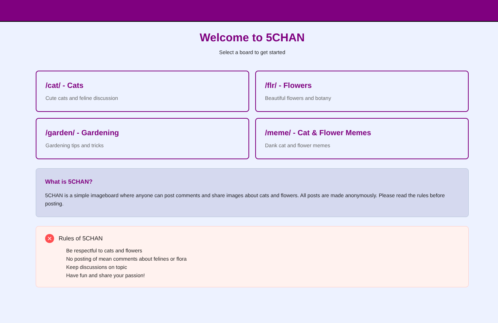
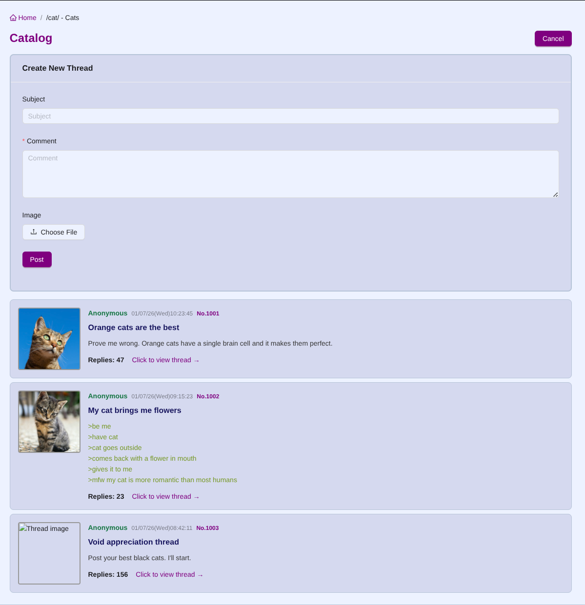
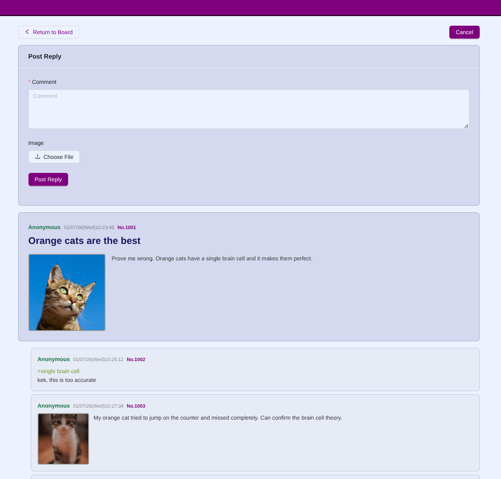

## Accessibility choices explanation

When designing the mockups, several accessibility choices were made to ensure that the application is usable by as many people as possible.

1. **Color Contrast**: High contrast colors were chosen for text and background to ensure readability for users. For example, dark text on a light background or vice versa.

2. **Font Size and Type**: Sans-serif fonts are generally easier to read on screens, and a minimum font size of 16px was used.

3. **Navigation**: Clear and consistent navigation elements were included to help users easily find their way around the application. This includes a visible menu and clearly labeled buttons.

Main/home page: 
Threads page: 
Detail thread page: 